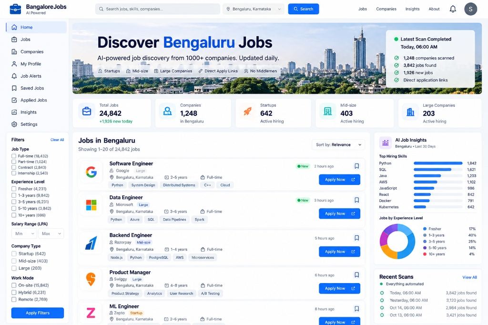
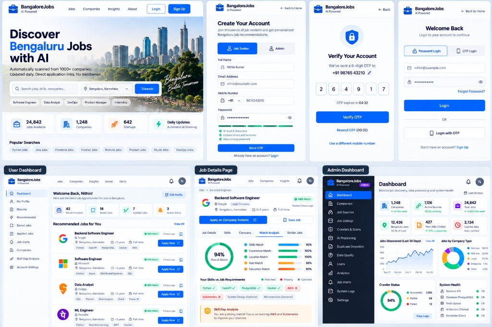
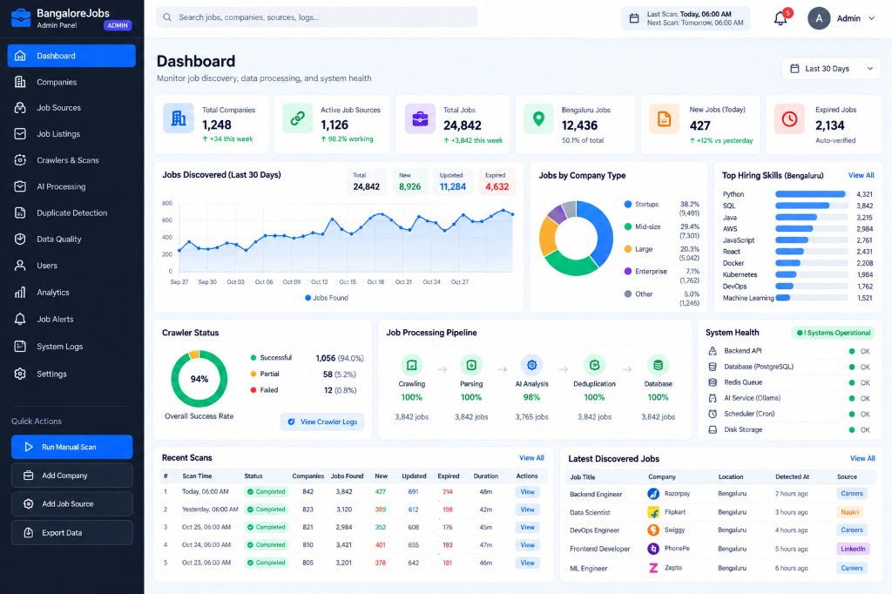

<div align="center">

  # 🚀 JobNexa — Bengaluru IT Job Intelligence & ATS Pipeline
  
  **An enterprise-grade, AI-powered engineering job discovery platform and automated ATS ingestion engine built specifically for Bengaluru's tech ecosystem.**

  <p align="center">
    <a href="https://github.com/Nithin560/jobnexa-ai-job-intelligence/stargazers"></a>
    <a href="https://github.com/Nithin560/jobnexa-ai-job-intelligence/network/members"></a>
    <a href="https://github.com/Nithin560/jobnexa-ai-job-intelligence/issues"></a>
    <a href="https://github.com/Nithin560/jobnexa-ai-job-intelligence/blob/main/LICENSE"></a>
  </p>

  <p align="center">
    
    
    
    
    
    
    
    
    
  </p>

  <p align="center">
    <a href="https://jobnexa-ai-job-intelligence.onrender.com/docs"><strong>Explore Live API Docs (Swagger) »</strong></a>
    <br />
    <a href="#-key-features">Key Features</a> •
    <a href="#-system-architecture">System Architecture</a> •
    <a href="#-tech-stack">Tech Stack</a> •
    <a href="#-quick-start">Quick Start</a> •
    <a href="#-api-endpoints">API Reference</a>
  </p>

</div>

---

## 📸 Platform Interface Preview

<div align="center">
  
</div>

<br/>

| 🎯 Candidate Discovery & Match Analysis | ⚙️ Admin Operations & Crawler Telemetry |
|:---:|:---:|
|  |  |

---

## 🌟 Key Features

- **⚡ Automated ATS Multi-Source Ingestion Pipeline:** Continuously ingests and normalizes openings directly from official enterprise ATS portals (**Greenhouse, Lever, Ashby, SmartRecruiters, Workday**) across **120+ top tech employers** (Razorpay, Swiggy, CRED, Zerodha, Flipkart, PhonePe, Infosys, Bosch).
- **🛡️ 98% Deduplication & Verified Locations:** Employs SHA-256 job fingerprinting, regex location sanitization, and JD validation to ensure **zero expired postings, zero third-party spam, and 100% direct official career links**.
- **🧠 7 IT Role Families & NLP Skill Matching:** Automated skill extraction and classification across:
  1. *Software & Product Engineering*
  2. *Cloud, SRE & DevOps*
  3. *Data Engineering & AI/ML*
  4. *Cybersecurity & InfoSec*
  5. *QA & SDET*
  6. *Hardware & Embedded Systems*
  7. *Tech Product & Architecture*
- **🎓 Dual Experience Tiers:**
  - **Fresher Track (0–1 Years):** Entry-level roles, graduate engineering trainees, and internships with on-demand instant refresh.
  - **Experienced Track (1+ Years):** Tailored for mid, senior, lead, and staff engineering openings.
- **📍 Bengaluru Tech-Hub Neighborhood Filtering:** Granular geographic filtering across *Outer Ring Road (ORR) & Bellandur, Whitefield, Koramangala & HSR Layout, Electronic City, Manyata Tech Park, and Indiranagar/Central*.
- **🔒 Enterprise Security & Dual-Factor Auth:** Role-Based Access Control (`candidate` vs `admin`), password hashing with **Bcrypt**, secure **JWT access tokens**, and automated **SMTP_SSL / Port 465 OTP verification**.
- **📊 Real-Time Operations Telemetry:** Built-in Admin Console with Recharts analytics tracking daily scanner throughput, source health, response latency, and system alerts.

---

## 🏗️ System Architecture

```text
┌──────────────────────────────────────────────────────────────────────────────────┐
│                             CLIENT LAYER (Vercel)                                │
│   React 18  •  TypeScript  •  Tailwind CSS  •  Vite  •  Lucide Icons  •  Recharts  │
└────────────────────────────────────────┬─────────────────────────────────────────┘
                                         │ HTTPS / REST JSON
                                         ▼
┌──────────────────────────────────────────────────────────────────────────────────┐
│                          API & BACKEND LAYER (Render)                            │
│           FastAPI (Python 3.11+)  •  Pydantic v2  •  AsyncIO  •  HTTPX           │
│  ┌───────────────────────┐  ┌───────────────────────┐  ┌──────────────────────┐  │
│  │  JWT & RBAC Security  │  │  SMTP / SSL Email OTP  │  │   Health & Telemetry │  │
│  └───────────────────────┘  └───────────────────────┘  └──────────────────────┘  │
└───────────────────┬──────────────────────────────────────────────┬───────────────┘
                    │                                              │
                    ▼                                              ▼
┌──────────────────────────────────────┐     ┌─────────────────────────────────────┐
│       DATABASE & STORAGE LAYER       │     │     BENGALURU ATS INGESTION PIPELINE │
│  PostgreSQL 15+ (Production)         │     │  • Greenhouse ATS REST Connector     │
│  SQLite (Local Development)          │     │  • Lever ATS REST Connector          │
│  SQLAlchemy 2.0 ORM Engine           │     │  • Ashby & SmartRecruiters Feed      │
│  Connection Pooling & Migrations     │     │  • SHA-256 Deduplication & Fingerprint│
└──────────────────────────────────────┘     └─────────────────────────────────────┘
```

---

## 💻 Tech Stack

| Domain | Technologies |
|---|---|
| **Frontend** | React 18, TypeScript, Vite, Tailwind CSS, Lucide React, Recharts |
| **Backend** | Python 3.11+, FastAPI (Async), Pydantic v2, SQLAlchemy 2.0 ORM, HTTPX |
| **Database** | PostgreSQL 15+ (Production) / SQLite (Local Dev) |
| **Security & Auth** | JWT (JSON Web Tokens), Bcrypt Password Hashing, SMTPS (Port 465 SSL) |
| **Data Ingestion** | Greenhouse API, Lever API, Ashby API, SmartRecruiters, BeautifulSoup4 |
| **DevOps & Cloud** | Docker, Render (Backend PaaS), Vercel (Edge Frontend), Git & GitHub Actions |

---

## 🚀 Quick Start Guide

### Prerequisites
- **Node.js:** v18.0.0 or higher
- **Python:** v3.11 or higher
- **Git**

### 1. Clone Repository
```bash
git clone https://github.com/Nithin560/jobnexa-ai-job-intelligence.git
cd jobnexa-ai-job-intelligence
```

### 2. Backend Setup
```bash
cd backend
python -m venv .venv

# Activate Virtual Environment:
# On Windows:
.venv\Scripts\activate
# On Linux / macOS:
source .venv/bin/activate

# Install dependencies:
pip install -r requirements.txt

# Start backend server:
uvicorn app.main:app --reload --host 0.0.0.0 --port 8000
```
> Backend API will be live at: `http://localhost:8000`  
> Interactive Swagger Documentation: `http://localhost:8000/docs`

### 3. Frontend Setup
In a new terminal:
```bash
cd frontend
npm install
npm run dev
```
> Frontend Application will be running at: `http://localhost:5173`

---

## 📡 Core API Reference

| Method | Endpoint | Description | Auth Required |
|:---:|---|---|:---:|
| `POST` | `/api/v1/auth/login` | Authenticate user and receive JWT access token | No |
| `POST` | `/api/v1/auth/send-otp` | Generate and dispatch 6-digit verification OTP | No |
| `POST` | `/api/v1/auth/verify-register` | Verify OTP, create account, and auto sign-in | No |
| `GET` | `/api/v1/jobs` | Paginated job search with multi-criteria filters | Optional |
| `GET` | `/api/v1/jobs/{id}` | Detailed job listing metadata and verified URL | No |
| `GET` | `/api/v1/jobs/stats/overview` | Bengaluru tech hub metrics and role counts | No |
| `POST` | `/api/v1/admin/scanner/trigger` | Trigger live ATS career portal scan | Admin Only |
| `GET` | `/api/v1/admin/overview` | Admin crawler throughput and source health | Admin Only |

---

## 👨‍💻 Author

**Vandana Nithin**  
*Full Stack Developer & AI Engineer*  
- **GitHub:** [@Nithin560](https://github.com/Nithin560)  
- **LinkedIn:** [Nithin Vandana](https://linkedin.com)  

---

## 📄 License

This project is licensed under the [MIT License](LICENSE) — see the LICENSE file for details.
